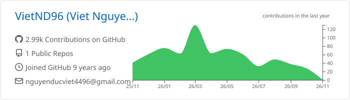
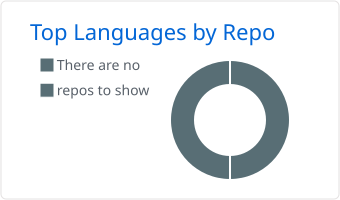
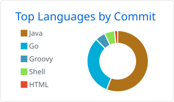
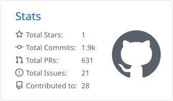
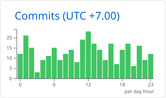
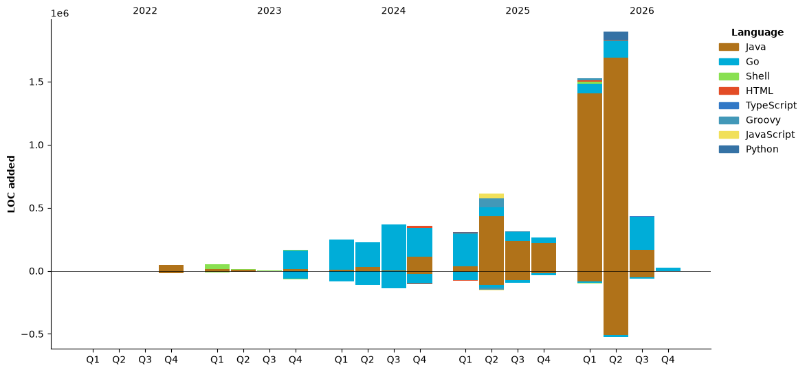

<h1 align="left">Hi there 👋, I'm Viet Nguyen</h1>
<h3 align="left">A passionate Software Quality Engineer</h3>

- 🔭 I’m currently working at [HRS Group](https://connect.hrs.com/).

- 🌱 I’m currently focused on **building software-defined test automation ecosystem that integrates CI/CD toolchains, AI-driven workflows, and shift-everywhere testing practices to deliver faster, more intelligent, and scalable testing**

- 👯 I’m looking to share with you about [Happy TestOps](https://github.com/ndviet)

- 👨‍💻 All of my projects are available at [Happy TestOps](https://github.com/ndviet)

- 💬 Ask me about **testing in general, test automation in the AI era, CI/CD toolchains**

- 📫 How to reach me **nguyenducviet4496@gmail.com**

- 📄 Know about my experiences via [LinkedIn](https://www.linkedin.com/in/vietnd96/)

<p align="left">  </p>

[](#)
[](#)
[](#)
[](#)
[](#)

<h3 align="left">Connect with me on <a href="https://wakatime.com/@vietnd96" target="_blank" rel="noreferrer">
WakaTime</a> </h3>

<!--START_SECTION:waka-->


**🐱 My GitHub Data** 

> 📦 103.1 kB Used in GitHub's Storage 
 > 
> 🏆 611 Contributions in the Year 2026
 > 
> 💼 Opted to Hire
 > 
> 📜 1 Public Repository 
 > 
> 🔑 1 Private Repository 
 > 
**I'm an Early 🐤** 

```text
🌞 Morning                9121 commits        ██████░░░░░░░░░░░░░░░░░░░   25.46 % 
🌆 Daytime                11003 commits       ████████░░░░░░░░░░░░░░░░░   30.71 % 
🌃 Evening                9905 commits        ███████░░░░░░░░░░░░░░░░░░   27.65 % 
🌙 Night                  5798 commits        ████░░░░░░░░░░░░░░░░░░░░░   16.18 % 
```
📅 **I'm Most Productive on Wednesday** 

```text
Monday                   6429 commits        ████░░░░░░░░░░░░░░░░░░░░░   17.94 % 
Tuesday                  6000 commits        ████░░░░░░░░░░░░░░░░░░░░░   16.75 % 
Wednesday                6601 commits        █████░░░░░░░░░░░░░░░░░░░░   18.42 % 
Thursday                 5429 commits        ████░░░░░░░░░░░░░░░░░░░░░   15.15 % 
Friday                   5145 commits        ████░░░░░░░░░░░░░░░░░░░░░   14.36 % 
Saturday                 3811 commits        ███░░░░░░░░░░░░░░░░░░░░░░   10.64 % 
Sunday                   2412 commits        ██░░░░░░░░░░░░░░░░░░░░░░░   06.73 % 
```


📊 **This Week I Spent My Time On** 

```text
🕑︎ Time Zone: Asia/Ho_Chi_Minh

💬 Programming Languages: 
Other                    58 hrs 7 mins       ██████████████░░░░░░░░░░░   56.58 % 
Markdown                 17 hrs 45 mins      ████░░░░░░░░░░░░░░░░░░░░░   17.29 % 
Python                   11 hrs 18 mins      ███░░░░░░░░░░░░░░░░░░░░░░   11.01 % 
JSON                     3 hrs 52 mins       █░░░░░░░░░░░░░░░░░░░░░░░░   03.78 % 
YAML                     3 hrs 21 mins       █░░░░░░░░░░░░░░░░░░░░░░░░   03.26 % 

🔥 Editors: 
Claude Code              44 hrs 47 mins      ███████████░░░░░░░░░░░░░░   43.60 % 
MicrosoftEdge            21 hrs 56 mins      █████░░░░░░░░░░░░░░░░░░░░   21.37 % 
MicrosoftTeams           16 hrs 28 mins      ████░░░░░░░░░░░░░░░░░░░░░   16.03 % 
Terminal                 16 hrs 24 mins      ████░░░░░░░░░░░░░░░░░░░░░   15.98 % 
MicrosoftOutlook         2 hrs 17 mins       █░░░░░░░░░░░░░░░░░░░░░░░░   02.24 % 

💻 Operating System: 
Mac                      102 hrs 43 mins     █████████████████████████   100.00 % 
```

🤖 **AI Coding This Week** 

```text
⏱ AI Coding Time: 54 hrs 42 mins (53.26%)

✍️ 110,115 lines written by AI, 0 lines written by hand (100.0% AI-written)

🔤 91,168,682 Input Tokens, 14,188,013 Output Tokens

💵 $1799.03 Estimated AI Cost This Week

🧠 93 AI Sessions, 1075 AI Prompts

Opus                     79,306 lines        █████████████████░░░░░░░░   69.70 % 
Sonnet                   24,363 lines        █████░░░░░░░░░░░░░░░░░░░░   21.41 % 
Fable                    10,117 lines        ██░░░░░░░░░░░░░░░░░░░░░░░   08.89 % 

🔎 AI Coding Insights:
🤖 AI-Driven — 100.0% of written lines came from AI
📚 Verbose Prompter — average 1,911 characters per prompt
🔁 Iterative Prompter — average 12 prompts per session
🚀 High AI Trust — 0.0% of changed lines were hand-edited
```

**I Mostly Code in Java** 

```text
Java                     11 repos            █████████░░░░░░░░░░░░░░░░   35.48 % 
Groovy                   5 repos             ████░░░░░░░░░░░░░░░░░░░░░   16.13 % 
Python                   3 repos             ██░░░░░░░░░░░░░░░░░░░░░░░   09.68 % 
JavaScript               2 repos             ██░░░░░░░░░░░░░░░░░░░░░░░   06.45 % 
Shell                    1 repo              █░░░░░░░░░░░░░░░░░░░░░░░░   03.23 % 
```


**Timeline**




 Last Updated on 01/11/2026 04:14:08 UTC
<!--END_SECTION:waka-->
